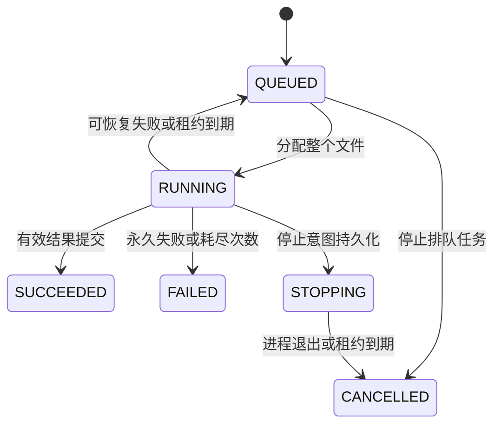

# 架构与可靠性契约

一个文件一个Task，Task包含完整本地DAG。一个Attempt始终绑定同一个执行器会话。
执行器预建固定数量的常驻运行子进程，每个槽位同时只执行一个Task，正常完成后复用
进程、DAG线程池和页/块线程池；任务上下文、参数、结果、进度和日志独立。
详见 [常驻运行进程与资源复用](resident-runners.md)。
0.4.0 在执行器内跨槽位共享算子 CPU/内存预算，CPU/IO 各有固定 DAG/页块池；
资源等待不占执行线程，见 [算子级资源调度](operator-scheduling.md)。
管控API负责持久化和命令，后台线程恢复到期任务，执行器主动领取。
PostgreSQL是生产状态依据，SQLite仅支持单机开发。所有Pod在相同路径挂载RWX文件系统。

## 状态

Attempt为追加记录，终态为SUCCEEDED、FAILED、CANCELLED或LOST。
自动重试追加Attempt并从第一步骤开始；手动重试创建新Task，幂等键包含原Task ID。

## 事务与租约

- 修改在数据库事务中进行，状态与事件一起提交。
- PostgreSQL写入使用事务级advisory lock；SQLite使用BEGIN IMMEDIATE。
  该版本优先单管控正确性，不在网络或业务执行期间持有事务。
- 领取持久化任务、Attempt、随机令牌和请求ID；成功领取重放返回同一分配。
- 数据库时间决定租约，续租不超过任务deadline。
- 执行器用请求开始的单调时间计算保守有效期；独立看门狗不受网络请求阻塞影响，
  管控不可用时也停止过期任务。
- 续租、进度和提交必须匹配当前Attempt、会话、令牌、状态和有效期。
- 完成响应丢失可重放同一请求；不同结果的重放被拒绝。
- 取消与完成由事务排序，取消先提交则结果不能变成成功。

网络分区可能导致新旧Attempt短暂同时计算，但只有有效结果被接受。
外部副作用必须使用稳定任务/记录标识做幂等，不保证任意业务只执行一次。

## 输入与输出

支持管理 API 上传本地文件到共享 data-root。文件与上传记录通过同一次目录重命名发布，临时文件不会作为任务输入；上传不创建任务，也不改变单文件、单执行器的执行方式。上传记录位于输入卷，执行记录仍在 PostgreSQL，见 [file-uploads.md](file-uploads.md)。

管控提交时流式计算SHA256，任务开始和结束核对输入未变化。输入必须位于data-root
且在任务生命周期内保留。输出写 outputs/<task-id>/<attempt-id>/ 独立目录，
Task.result的已提交manifest引用是正式结果。消费者不能通过扫描输出目录判断成功。
失败输出保留供诊断，清理不得删除成功引用，可用 gc-failed-outputs 预演和清理过期失败目录；成功引用与输入受保护。

## 停止与恢复

Pod/节点故障由租约感知，无需K8S API权限。指数退避与max_attempts控制重试。
管控重启核对持久化Attempt，有效执行继续、过期执行重排。数据库不可用期间暂停
分配和提交，恢复后核对，不能根据内存推断成功。
停止先持久化STOPPING，再SIGTERM协作退出，超过stop_grace发送SIGKILL到任务进程组。
取消/失败/租约失效后，确认子进程退出并清理同组剩余进程后才释放槽位并补建。
成功任务在结果与日志写完、线程工作清空且无遗留子进程后复用槽位；否则回收进程。Linux父进程死亡信号保护直接
任务子进程。算子启动的子进程必须留在同一进程组；任意脱离管理的daemon不受本机
隔离保证。K8S会终止容器进程。

## 容量与边界

pool、runtime_version、槽位、CPU和内存同时匹配。runtime_version由操作员定义并
与不可变业务镜像对应。准入预算不是子进程硬隔离，Pod resources提供容器边界。
算子模式领取前在数据库过滤pool、runtime_version及最大单算子需求是否能放入执行器；
运行时由执行器共享预算控制实际并发。兼容任务模式仍按整任务剩余CPU/内存领取。路由索引减少不相关
队列扫描。每轮最多领取32个文件以填充空槽位，更多槽位在后续轮次继续填充。
任务里的context.map用于页/块并行：限制工作线程与生产者预取，结果按输入顺序
流式返回。它不把页/块拆到其他执行器；DAG和算子内部并行预算由业务共同控制。
最多64个API请求线程，请求/结果大小有界，业务执行不占API线程。
当前单管控无需跨实例选主，主备未交付。数据库与共享存储HA、备份由部署环境提供。

## 内部组件的通信与执行路径（0.7.0）

监督进程按固定间隔汇总进度并用 pulse 发送心跳、批量续租、领取 ID 和执行器快照；
任务完成时通过管道立即唤醒监督进程，上报结果并复用槽位，短任务吞吐不再受心跳间隔
限制。空闲槽位阻塞在派发管道上，固定数量的运行进程、线程池和算子缓存继续复用。

共享 SQLite 预算仍是执行器本机的原子资源依据，和 PostgreSQL 的持久任务状态分离。
算子/任务释放资源后通知其他进程；通知不是授权，醒来必须重新检查预算，丢失通知也
会在至多 0.5 秒后的检查中恢复。完成 future 唤醒 DAG 协调，不持续轮询未完成 future。
资源等待不上执行线程，公平回填/老请求保护、内存上限和 CPU/IO 配额保持不变。

PostgreSQL 用有界连接池复用连接，写事务锁按 schema 隔离；没有到期执行时恢复扫描
只做索引读取。健康文件是可丢失的原子快照，不 fsync；数据库任务/尝试/事件的提交
仍保持持久事务语义。只记录实际失败和恢复，重复故障计数并限频，成功轮询按 DEBUG
查看。运行身份包含会话、槽位 generation、Attempt，PID 是辅助信息。
