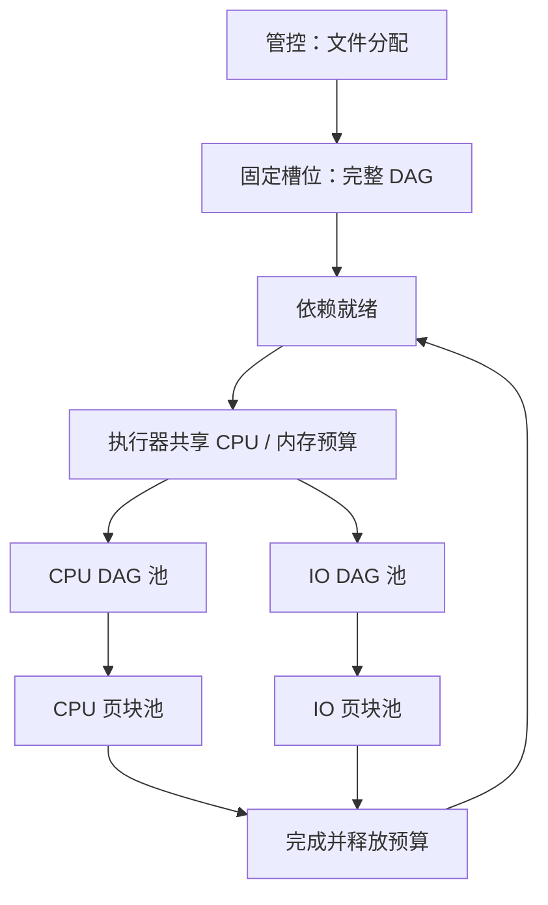

# 算子级资源调度（0.4.0）

一个文件仍对应一个 Task，每次 Attempt 的完整 DAG 绑定同一执行器、同一常驻槽位进程。
算子和页块都不跨节点迁移。执行器启动时创建固定 `slots` 个进程，每个进程拥有独立的
CPU/IO DAG 池和 CPU/IO 页块池，跨文件复用；不会按算子类型或任务动态增加进程。

## 两层调度

管控按 `pool`、`runtime_version`、空槽位以及最大单算子的 CPU/内存需求分配整个文件。
分配不预占整段任务的资源。执行器内部根据依赖就绪状态，在共享预算中申请每个算子的
CPU、内存；CPU/IO 算子分别限制并发。只有申请成功的节点进入线程池，完成后释放。
等待资源的节点不占业务线程，任务保持续租、可停止，Attempt 超时包含资源等待时间。

执行器本地 SQLite WAL 原子协调所有常驻进程的准入，文件位于会话的 work-root 下，
不要放在共享 PVC。它只保存临时资源请求，任务记录仍以管控 PostgreSQL 为准。
同类资源请求按 FIFO 排队，CPU 不足时 IO 可推进；共享内存不足时停止后续准入，
避免大内存节点被持续的小节点饿死。这是保守的公平策略，可能暂时降低资源利用率。
节点不抢占正在运行的节点，也不自动探测代码属于 CPU 或 IO，分类由 DAG 作者配置。



## 配置示例

```python
from dataflowcore.sdk import Pipeline

flow = (
    Pipeline("document", dag_workers=2, io_workers=8)
    .step(
        "read",
        "dataflowcore.operators:read_text",
        workload="io",
        resources={"cpu": 0.1, "memory_mb": 64},
    )
    .step(
        "count",
        "dataflowcore.operators:word_count",
        depends_on=["read"],
        workload="cpu",
        resources={"cpu": 2, "memory_mb": 256},
    )
    .step(
        "write",
        "dataflowcore.operators:write_json",
        depends_on=["count"],
        workload="io",
        resources={"cpu": 0.1, "memory_mb": 32},
    )
)
spec = flow.spec("/dataflow/input.txt")
```

API JSON 在 `steps[]` 上使用相同的 `workload`、`resources` 字段。节点 `parameters`
与资源配置相互独立，仍可在提交时填写；`context.workload`、`context.resources` 提供
当前节点的规范化声明，`inputs` 保留上游结果。

| 字段 | 含义与约束 |
| --- | --- |
| `scheduling` | 新提交默认 `operator`；`task` 为显式兼容整任务预留模式 |
| `steps[].workload` | `cpu` / `io`；未填写默认 `cpu` |
| `steps[].resources.cpu` | 0..1024 核，精度 0.001；CPU 算子至少 0.001，IO 可为 0 |
| `steps[].resources.memory_mb` | 正整数 MiB，至少 1；算子执行时的预估峰值 |
| `dag_workers` | 每文件同时运行的 CPU 算子上限，还受 runner CPU DAG 池上限限制 |
| `io_workers` | 每文件同时运行的 IO 算子上限，默认 16，还受 runner IO DAG 池限制 |
| 顶层 `cpu` / `memory_mb` | 未显式配置节点的默认值；规范化后为最大单算子需求，仅用于放置 |

省略节点资源时继承顶层默认值（CPU 1、内存 256 MiB），随后 API 返回完整节点声明。
显式配置所有节点后，调整顶层 CPU/内存不会覆盖它们。并行节点的需求在执行时相加，
超过执行器可用预算的节点等待，不能把“最大单节点需求”当成整个 DAG 的并行总占用。

## 执行器与内部并行

```bash
dataflow worker --slots 4 --cpu 4 --memory-mb 2048 \
  --runner-dag-workers 2 --runner-map-workers 4 \
  --runner-io-workers 8 --runner-io-map-workers 16 --io-concurrency 16
```

`--cpu`、`--memory-mb` 是**整个执行器**的可用算子预算，所有槽位共享。
`--io-concurrency` 是整个执行器同时运行的 IO 算子上限（默认 32），不是 HTTP 请求数。
四个池的上限按槽位配置，线程懒创建；上述配置业务线程最多
`4 × (2 + 4 + 8 + 16) = 120` 个，另有固定管理/日志线程。按实际负载调小池上限，
增加槽位会增加常驻解释器和缓存开销。

`context.map` 随节点类型选择 CPU 或 IO 页块池。CPU 页块同时在途数量还受
`ceil(resources.cpu)` 限制，至少一个；IO 页块受 IO 页块池限制。所有 map 共享所属
槽位的对应池，不会为每次 map 新建池。每个 map 仍受 `max_workers`、`max_pending`
约束，按顺序返回，禁止嵌套。迭代器必须消费完或关闭；未完成的迭代器使任务失败，
对应资源保持预留到进程组被回收。异步 IO 算子使用同样的准入与并发预算。

需要用多个核的单个 CPU 算子必须显式声明相应 CPU，并通过 `context.map` 或已配置
线程数的原生库并行；把 `cpu` 填大不会自动把普通函数拆成多线程。原生 BLAS/OpenMP
或自行创建的线程不能由框架限流，须统一限制或使用托管池。

CPU/内存声明是准入预算，不是每个 Python 线程的硬限额，也不是实际 RSS 测量。
Pod/cgroup 提供硬限制。`memory_mb` 应包含当前算子的临时缓冲和执行期间载入的模型；
跨任务保留的模块、`context.resource` 缓存、解释器、上游结果和监督进程占用不会在
节点结束后消失，必须在 Pod 内存与算子预算之间另留足余量。大量上游产物写文件并
传递引用，不要缓存整份文件或任务 Context。持久模型宜预估每槽位缓存总量，或放到
独立推理服务；当前没有自动缓存驱逐、实际 RSS 自适应或逐算子 cgroup 隔离。

## 故障与观测

节点状态包含 `WAITING_RESOURCES`，进度记录类型、声明、等待时间、执行时长。
Attempt.progress.scheduler 是执行器共享资源快照（预留 CPU/内存、运行/等待算子数、
IO 并发和峰值），不同任务里的同一执行器快照不能相加。`GET /v1/workers` 使用活跃
Attempt 的最近快照，空闲时为 `null`；心跳周期决定更新延迟。成功结果也记录共享预算
的会话峰值，并保留原有本任务 CPU 时间和运行进程生命周期 RSS 峰值。

前端「DAG 编排 → 节点配置」填写类型、CPU、内存；「任务详情」显示资源等待和时长，
「执行器」显示共享预留、运行/等待数量和 IO 上限。配置校验与提交通过独立 API。

失败、停止、超时、租约丢失或运行进程崩溃时，监督进程先终止整个运行进程组，再回收
该进程唯一代次的资源请求，补建槽位。不会在旧线程仍执行时提前释放预算。Pod 死亡
使本地预算失效，新 Pod 建立新会话；管控租约负责按原 DAG 整文件重试，无断点续跑。

0.4.0 沿用管控数据库 schema 1。旧持久化定义未包含 `scheduling` 时仍按任务预留，
手动/自动重试保持原模式与运行环境。升级镜像和 `runtimeVersion` 为 0.4.0，新提交
默认使用算子模式；旧 0.3.0 文件保留旧执行器直到完成，或取消后明确用新版本重提。
显式 `scheduling: task` 的新任务不接受节点资源字段，避免配置被静默忽略。

完整业务基准：

```bash
python scripts/benchmark_operator_scheduling.py --repetitions 3
```

同一版本、同一固定槽位配置交错比较任务与算子模式，真实 HTTP 文档向量入库，逐一
验证成功数、重试数、索引行数、所有产物哈希与共享预算峰值。原始报告位于
`docs/benchmarks/operators`；它度量 IO 等待场景的资源释放收益，不代表生产模型加速比。
